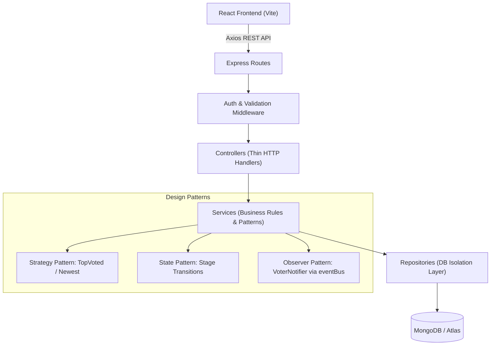

# UpNext - Product Feedback & Roadmap Platform

**UpNext** is a modern, professional, and streamlined 3-tier MERN feedback board and roadmap platform. It allows product teams to collect feature requests from users, enables the community to upvote and discuss ideas, provides administrators with strict state-machine controls for managing status transitions, and automatically notifies voters when features progress.

---

## 🏛 Architecture & Design Patterns

The backend follows a strict layered separation of concerns:
```
React (Axios) ➔ Route ➔ Middleware ➔ Controller ➔ Service ➔ Repository ➔ MongoDB
```



### Design Patterns Implemented

1. **Repository Pattern** (`server/src/repositories/`):
   - Only layer that talks directly to MongoDB. Services stay decoupled from database driver details.
2. **Singleton Pattern** (`server/src/config/db.js`):
   - Single shared database connection across the entire lifecycle, with zero-config embedded MongoDB fallback.
3. **Strategy Pattern** (`server/src/services/ranking/`):
   - Encapsulates ranking rules (`TopVotedStrategy`, `NewestStrategy`). New sort strategies can be introduced without modifying existing business logic.
4. **State Pattern** (`server/src/services/status/`):
   - Strict status transition enforcement:
     - `Under Review` ➔ `Planned`, `Declined`
     - `Planned` ➔ `In Progress`, `Declined`
     - `In Progress` ➔ `Shipped`
     - `Shipped` ➔ *terminal*
     - `Declined` ➔ *terminal*
5. **Observer Pattern** (`server/src/services/observers/`):
   - Decoupled `VoterNotifier` listening on `statusChanged` events via `eventBus`, automatically persisting in-app notifications for all users who upvoted a request.

---

## 👥 Separate Portals & Authentication

UpNext provides **separate login flows and dedicated web pages** for Users and Admins to strictly enforce security and separation of duties:

| Role | Dedicated Webpage | Login Portal URL | Permissions & Capabilities |
|---|---|---|---|
| **Admin (Product Team)** | **Admin Console** (`/admin`) | `/admin/login` | • **Exclusive control to change request status**<br>• Enforced State machine transitions<br>• Add decline reasons<br>• Audit trail of past status transitions |
| **User (Customer / Voter)** | **Feedback Board & Roadmap** (`/`, `/roadmap`) | `/login` | • **Submit feature requests** (`/requests/new`)<br>• Upvote ideas (1 vote per user)<br>• Join discussions & comment<br>• Track roadmap & receive status alerts<br>• *Cannot alter statuses or access Admin Console* |
| **Visitor** | **Public Board & Roadmap** | *None required* | • View submitted feedback ideas<br>• View live public roadmap |

### Pre-Seeded Demonstration Accounts:
- **Admin Portal**: `admin@upnext.dev` / `Admin123!` (Direct access to Admin Status Console)
- **User Portal**: `sarah@example.com` / `User123!` (Customer feedback and voting account)

---

## 📋 Requirements Compliance Matrix

| ID | Requirement | Module | Status |
|---|---|---|---|
| **FR1** | Register and log in with email and password (bcrypt + JWT) | 1 | ✅ Implemented |
| **FR2** | Post a feature request (title, description) | 1 | ✅ Implemented |
| **FR3** | View all requests on a feedback board | 1 | ✅ Implemented |
| **FR4** | Upvote a request, one vote per user (atomic count & unique index) | 1 | ✅ Implemented |
| **FR5** | Comment on a request | 1 | ✅ Implemented |
| **FR6** | Sort board by top voted or newest (Strategy pattern) | 1 | ✅ Implemented |
| **FR7** | Admin changes a request's status | 2 | ✅ Implemented |
| **FR8** | Only valid status transitions are allowed (State pattern) | 2 | ✅ Implemented |
| **FR9** | Status endpoint is admin-only (`requireAdmin` middleware) | 2 | ✅ Implemented |
| **FR10** | Notify voters when status changes (Observer pattern) | 3 | ✅ Implemented |
| **FR11** | View notifications and mark them read (with unread badge) | 3 | ✅ Implemented |
| **FR12** | Public roadmap grouped by status (`Planned`, `In Progress`, `Shipped`) | 3 | ✅ Implemented |
| **FR13** | Filter board by status and paginate | 1 | ✅ Implemented |

---

## 🚀 Getting Started

### Prerequisites
- Node.js 18+ (tested on Node 20 & 24)
- npm 9+

### 1. Install & Configure Backend
```bash
cd server
npm install
```

The server includes zero-config fallback to an embedded in-memory MongoDB instance out of the box, or you can provide your own MongoDB Atlas connection in `.env`:
```env
PORT=5000
JWT_SECRET=upnext_super_secret_jwt_key_2026_secure
MONGO_URI=mongodb+srv://<user>:<password>@cluster0.mongodb.net/upnext?retryWrites=true&w=majority
```

Start the API:
```bash
npm start
# or npm run dev
```

### 2. Install & Start Frontend
```bash
cd ../client
npm install
npm run dev
```
Open **`http://localhost:3000`** in your browser.

---

## 🧪 Testing Checklist Verification

The backend includes an automated test suite verifying all 8 items from the specification:
```bash
npm test
```

### Test Results (14/14 Passing):
- ✅ **Check 1**: Register with an existing email fails (`400`)
- ✅ **Check 2**: Login with a wrong password fails (`401`)
- ✅ **Check 3**: A request cannot be posted without a token (`401`)
- ✅ **Check 4**: A second vote from the same user is rejected (`400`, unique compound index)
- ✅ **Check 5**: A normal user gets `403` on the admin endpoint
- ✅ **Check 6**: Dedicated Admin Portal rejects regular user with `403 Forbidden`
- ✅ **Check 7**: Administrator logs in successfully via dedicated Admin Portal
- ✅ **Check 8**: `Under Review` to `Shipped` is rejected (`400`, State pattern)
- ✅ **Check 9**: Admin can transition `Under Review` ➔ `Planned`
- ✅ **Check 10**: Changing status creates a notification for every voter (Observer pattern)
- ✅ **Check 11**: The roadmap shows only `Planned`, `In Progress`, and `Shipped`
- ✅ **Check 12**: Sorting strategies (`TopVotedStrategy` and `NewestStrategy`) respond cleanly

---

## 🔌 API Reference

| Method | Endpoint | Access | Purpose |
|---|---|---|---|
| `POST` | `/api/auth/register` | Public | Create new user account |
| `POST` | `/api/auth/login` | Public | User portal sign in |
| `POST` | `/api/auth/admin-login` | Admin Only | Dedicated admin portal sign in (rejects non-admin with 403) |
| `GET` | `/api/auth/me` | Authenticated | Current user profile |
| `GET` | `/api/requests?sort=top\|new&status=&page=&limit=` | Public | List requests with pagination & sorting |
| `POST` | `/api/requests` | Authenticated | Post a feature request |
| `GET` | `/api/requests/:id` | Public | Request details with discussion comments |
| `POST` | `/api/requests/:id/vote` | Authenticated | Upvote request (once per user) |
| `POST` | `/api/requests/:id/comments` | Authenticated | Add discussion comment |
| `PATCH` | `/api/admin/requests/:id/status` | Admin | Change status (State pattern enforced) |
| `GET` | `/api/admin/requests` | Admin | List all requests with admin filters |
| `GET` | `/api/admin/requests/:id/history` | Admin | Status change audit trail |
| `GET` | `/api/notifications` | Authenticated | User notifications & unread count |
| `PATCH` | `/api/notifications/:id/read` | Authenticated | Mark notification read |
| `PATCH` | `/api/notifications/read-all` | Authenticated | Mark all notifications read |
| `GET` | `/api/roadmap` | Public | Requests grouped by status |
